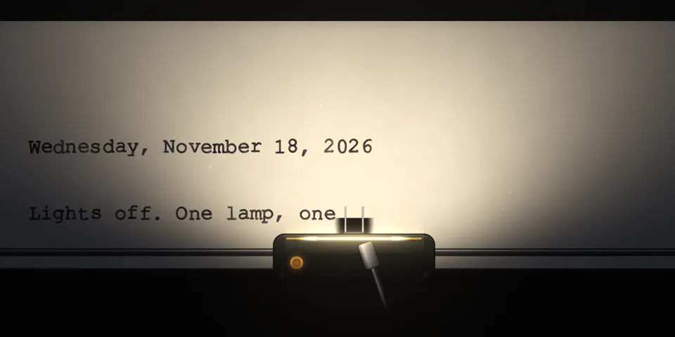
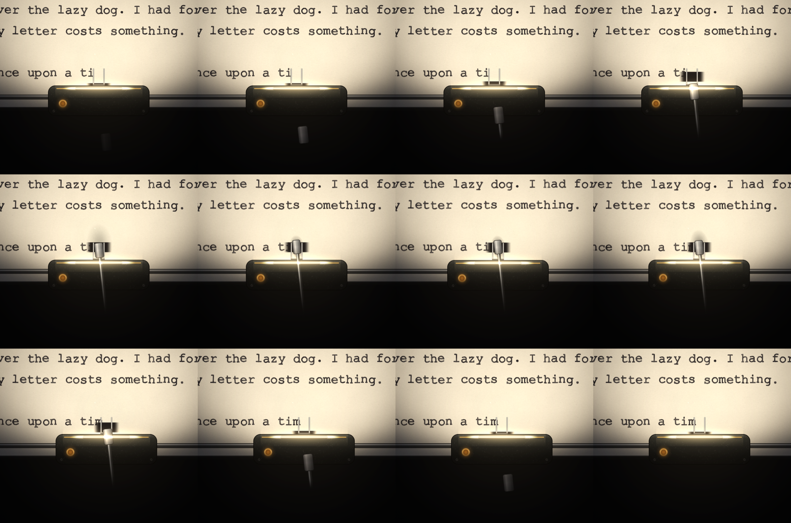

# Lamplight

<p align="center">
  
</p>

<p align="center">
  <a href="docs/demo.mp4">▶ 带声音的同一段演示（MP4，18 秒）</a>　打字机的声音是这个 App 的一半
</p>

一台关了灯才用的打字机。屏幕是黑的，只有打字头上的一盏小灯照着纸；每按一个键，
一根字杆从下面挥上来敲在纸上，留下一个带墨迹毛边的字。用来写每天的日记、读书笔记和随笔。

原生 Mac 应用：Swift + SpriteKit（底层是 Metal），画面全部由显卡绘制。画面里的所有图像都是
程序启动时画出来的，没有图片文件；声音来自真实打字机的录音。写下的东西只存在这台 Mac 上，不联网。

上面的演示是程序自己离屏渲染出来的：近景是镜头推近（App 里没有缩放），其余和 App 里看到、听到的一样。
整个窗口是这个样子：


一次敲击，逐帧看：



## 构建和运行

需要一台 Mac（macOS 14 或更新）和 Xcode 命令行工具（`xcode-select --install`），不需要完整的 Xcode。
克隆这个仓库后，在项目文件夹里：

```bash
./scripts/build.sh
```

```bash
open build/Lamplight.app
```

构建出的 App 只做了本机签名，在自己的 Mac 上可以直接打开。
这个项目是在 macOS 27、Swift 6.4 上构建和测试的，更早的系统没有验证过。

## 怎么用

打开就是今天的日记，机器会自己把日期（英文，如 Tuesday, November 17, 2026）打在纸的顶上，之后直接打字。
界面是英文的。

| 操作 | 效果 |
|---|---|
| 打字 | 字杆敲击，打字头右移一格。中文、日文等输入法也能用：拼音淡淡地显示在纸上，每按一键有一声轻响，上屏时才真正敲出来 |
| Return | 滑架回到行首，纸上卷一行 |
| 写到接近行尾 | 铃响一声；写满后自动换行（可在设置里关掉） |
| Delete | 修正带把上一个字揭掉，留下的淡痕在 10 秒内完全消失（设置里的 Delete 可换成 Strike out 或 Overtype） |
| Tab | 前进到下一个 4 格位置 |
| ← → ↑ ↓ | 挪动打字头、上下卷纸，可以回到任何位置补打 |
| 按住打字头拖动 | 打字头跟着鼠标沿这一行平滑移动，松手落在最近的一格。指针移到打字头上会变成手形（“纸走”模式下拖的是纸，这一行的纸面上也能抓） |
| 按住 ⌃F / ⌃J | 打字头向左 / 向右快速滑行：约 0.7 秒走完一整行，松开后减速停在一格上；轻点一下大约走一个词。滑行中按任何字键，就在当时的位置打字 |
| 滚动 | 把纸卷回去看前面写的，再打字时自动回到原处 |
| 鼠标移到纸上 | 指针带着一小片光，用来看灯照不到的地方 |
| 鼠标停住 6 秒 | 指针和它带的那片光一起隐去，一动鼠标就回来；按任何键也会立刻隐去（抽屉、设置开着或指针停在工具栏上时不隐） |
| 移动鼠标 | 底部出现工具栏，开始打字后自动隐去 |
| 切换输入法 | 打字头上短暂亮起 A / 中 / あ 等标记，平时打字头上没有任何文字 |

### 快捷键

| 按键 | 作用 |
|---|---|
| ⌘T | 今天的日记 |
| ⌘N | 新随笔 |
| ⇧⌘N | 新读书笔记 |
| ⌘O | 打开抽屉（所有写过的稿纸） |
| ⌘R | 换色带：黑 / 红（读书笔记里可以用红色抄原文、黑色写感想） |
| ⌘L | 开灯 / 关灯 |
| ⌘D | 打上现在的时间 |
| ⌘E | 导出为文本文件 |
| ⇧⌘C | 拷贝全文 |
| ⇧⌘M | 声音开 / 关 |
| ⌃⌘F | 全屏 |
| ⌃F / ⌃J（按住） | 打字头向左 / 向右滑行 |

滑行键没有用 Shift：Shift+F、Shift+J 就是大写的 F 和 J。要换成别的修饰键，改 `TypewriterView.glideModifier` 一处即可。

### 设置（工具栏最右边的滑块图标）

| 界面上的名字 | 作用 |
|---|---|
| Lamp | 台灯亮度 |
| Night | 夜色：没被灯照到的地方有多亮 |
| Volume | 音量 |
| Output | 声音正送往哪个设备（只显示；要换设备，点菜单栏的声音图标） |
| Sound | 选哪一套声音 |
| Size | 字号 |
| Travel | 走纸方式：Lamp moves（灯走）/ Paper moves（纸走） |
| Delete | 退格方式：Tape（修正带）/ Strike out（划掉）/ Overtype（叠打） |
| Chinese font | 中文字体：FangSong / Song / Kai |
| Return automatically… | 写到行尾自动换行 |
| Dust in the lamplight | 灯光里的浮尘 |

## 声音

敲击、空格、换行、删除、铃声都取自真实打字机的录音，切成单个声音后做成"声音包"，
放在 `Resources/Sounds/`。现在有四套，另有一套程序合成的作备用：

| 声音包 | 来源 | 特点 |
|---|---|---|
| Hermes · Natural | Hermes Precisa 305 手动打字机 | 很脆、很亮 |
| Hermes · ASMR | 同上，做了近讲处理 | 补了厚度，压掉刺耳的高频，把按键行程等细节提到前面 |
| Classic · Natural | 另一台机械打字机（来源未注明型号） | 更厚、更沉 |
| Classic · ASMR | 同上，做了近讲处理 | 更贴耳、更柔和；铃声和换行借用 Hermes 的录音 |
| Synthesised | 程序生成 | 备用 |

默认用的是 **Hermes · ASMR**。

试听：用浏览器打开 `docs/sound-samples.html`，里面有每一套的整段演示和单个声音。
在 App 里换：设置 → Sound。

每个敲击样本都从按键开始下压算起，录音里字锤落纸的那一刻和画面上字杆敲到纸的那一刻对齐。

录音来源和授权：

- 四套声音包，以及 `SoundSources/hermes-precisa-305/` 里的原始录音：Joseph Sardin 录制，
  [BigSoundBank.com](https://bigsoundbank.com)，CC0（公有领域）。
- `SoundSources/erika-5/typing.mp3`（1940 年的 Erika 5，只作参考，没有用进 App；试听页里嵌有同一段）：
  Work With Sounds / Konrad Gutkowski，[Wikimedia Commons](https://commons.wikimedia.org/wiki/File:WWS_Typewriter.ogg)，
  [CC BY 4.0](https://creativecommons.org/licenses/by/4.0/)，未作改动。

原始录音在 `SoundSources/`。改了切分或处理方式后，在项目文件夹里重新生成声音包和试听页：

```bash
.build/release/Lamplight --build-packs
```

## 数据在哪里

全部存在自己的 Mac 上，不联网：

```
~/Library/Application Support/Lamplight/Entries/
```

每张稿纸一个 JSON 文件，例如 `diary-2026-11-17-4D717AD1.json`。文件里记的是每一次敲击
（哪个字、在哪一格、什么颜色、敲得多重），所以叠打、划掉这些痕迹都能原样保留。
要拿到纯文本，用 ⌘E 导出。在抽屉里右键可以把一张纸移到废纸篓。
只打了日期、没写内容的纸不会保存。

## 项目结构

```
Sources/Lamplight/
  main.swift                入口；也处理下面的开发用参数
  Model/Entry.swift         稿纸的数据：字格、敲击、导出文本
  Model/Store.swift         读写 JSON 文件
  Scene/TypewriterScene.swift  整台机器：纸、打字头、字杆、灯，以及把按键变成敲击的时序
  Scene/Glyphs.swift        把字体变成色带墨迹；一行一行地画到纸上
  Scene/Art.swift           所有机器零件的贴图（程序绘制）
  Scene/Shaders.swift       纸纹、背景和灯光的着色器
  Scene/Layout.swift        所有尺寸，随窗口大小缩放
  Audio/SoundBank.swift     载入声音包，低延迟播放；输出设备变化后自己恢复
  Audio/AudioDevices.swift  查询系统的声音设备（设置里显示的"Output"）
  Audio/Synth.swift         程序合成的备用声音
  App/                      窗口、键盘和输入法、工具栏、抽屉、设置
  Dev/                      开发用：离屏渲染、演示影片、样例数据、窗口截图、声音包的制作工具
Sources/ObjCSafe/           几行 Objective-C：接住音频框架抛出的异常，免得 App 闪退
Resources/Sounds/           做好的声音包（打包进 App）
SoundSources/               原始录音
scripts/build.sh            构建并打包成 build/Lamplight.app（那一份正开着时不替换；加 --wait 则等它退出后换上）
scripts/make_icon.sh        用场景本身重画图标
```

## 开发用的工具

不开窗口，把场景渲染成 PNG（检查某一瞬间的画面，比如字杆敲到纸上的那一帧）：

```bash
.build/release/Lamplight --render-test /tmp/lamplight-shots
```

可以只渲染某几个场景，或换窗口尺寸：`... --render-test <目录> --size 1000x700 hero strike`。
场景名：`intro hero close strike cjk return red fade glide torch lights papermoves scroll`。
`glide` 除了出图，还逐帧打印打字头被拖动、滑行时的位置数据（每帧最大位移、位移的最大变化、有没有倒退）
和最后落在第几格。

重拍 README 顶上的演示（离屏渲染，不开窗口、不出声；音轨用声音包的录音离线混成）：

```bash
.build/release/Lamplight --make-demo /tmp/lamplight-demo
```

它写出 `demo.mp4`（60 帧、带声音）和一组小图，并打印把小图压成 `demo.webp` 的那条 `img2webp` 命令
（`img2webp` 来自 Homebrew 的 `webp`）。演的内容和镜头在 `Dev/DemoFilm.swift` 里。

把所有合成的声音导出成 WAV，并打印音量：

```bash
.build/release/Lamplight --dump-sounds /tmp/lamplight-sounds
```

试用时不想碰真实的稿纸、也不想出声，用这两个环境变量：

```bash
LAMPLIGHT_DATA_DIR=/tmp/lamplight-data LAMPLIGHT_MUTE=1 build/Lamplight.app/Contents/MacOS/Lamplight --demo "自动打出这句话"
```

其他参数：`--seed-demo <目录>` 生成几张样例稿纸；`--keys "abc<ret><del>"` 发送真实按键事件
（`<glide-left:0.4>` / `<glide-right:0.4>` 是按住 ⌃F / ⌃J 那么多秒再松开）；
`--drag "-20:0.5@4"` 在第 4 秒按住打字头、0.5 秒内向左拖 20 格再松手（真实的鼠标事件）；
`--pointer "0.35,0.4@5"` 在第 5 秒把指针移到窗口的那个位置（宽、高的比例），并打印它静止后的处理；
`--carriage-log` 每 0.05 秒打印打字头的位置和光标所在的格；
`--capture <文件> --capture-at <秒>` 让 App 给自己的窗口拍照（`--capture-at 4,6.5` 拍多张）；`--profile` 退出前打印帧率；
`--no-activate` 启动时不抢键盘焦点；`--quit-after <秒>` 自动退出；
`--sound-pack <包名>` 指定声音包；`--record-audio <文件>` 把 App 实际播放的声音录下来（静音时也能录）；
`--audio-log` 退出前打印声音引擎经历过的启动、停止和设备变化；
`--audio-flap "设备名@秒,设备名@秒"` 在指定时刻把输出切到别的设备，检查声音能否自己恢复；
`--english-header <稿纸.json>` 把一张旧日记顶上的中文日期改打成英文（只在那一行确实是机器打的日期时才动）。

所有 `--` 开头的试用参数都必须和 `LAMPLIGHT_DATA_DIR` 一起用，否则程序拒绝启动——这样试用永远碰不到
真正的日记。另外两个环境变量：`LAMPLIGHT_AUDIO_DEVICE="MacBook Pro Speakers"` 让试用的声音走指定设备
（不去碰正戴着的耳机），`LAMPLIGHT_AUDIO_IDLE=2` 把"空闲多久释放声音设备"缩短到 2 秒。

不用耳朵检查声音的几个工具：`--audio-scan <文件>` 列出录音里的每一个声音及其响度、长度、明暗；
`--spectrogram <文件> <起点秒> <长度秒> <输出.png>` 把声音画成频谱图；
`--audio-trace <文件> <起点秒> <长度秒>` 打印逐 10 毫秒的电平；
`--audio-balance <文件>` 报告整段的频段分布和响度。

## 听不到声音时

1. 打开设置看 **Output**：Lamplight 的声音总是送往 Mac 当前选中的输出设备。
2. 如果那里写的是 AirPods 这类同时连着手机的耳机：耳机的声音一次只归一台设备。手机把它拿走以后，
   Mac 上仍然显示选的是耳机，但 Mac 播放的任何声音都到不了耳朵。点菜单栏的声音图标重新选一次耳机，
   或者改选"MacBook Pro 扬声器"。
3. 别的 App 一打开耳机的麦克风，AirPods 会切到通话模式约两秒再切回来，这期间声音会断一下、音质变差。
   想避免：系统设置 → 声音 → 输入，选"MacBook Pro 麦克风"。

2026-11-17 修过一个相关的 bug：以前只要输出设备变化一次（上面第 3 条每次都算），Lamplight 就一直
没声，直到重开。现在会在几十毫秒内自己恢复。

## 目前的状况

已经验证的：

- 画面：整体、敲击逐帧、换行、红色色带、修正带、开灯、纸走模式、回看、三种窗口尺寸。
- 真实 App：启动、按键输入（含 Return / Delete / Tab / 方向键）、抽屉、设置面板、保存后重开接着写。
- 拖动和滑行（2026-11-17）：用真实的鼠标、按键事件在真窗口里跑过。拖 30 格用 0.4 秒时打字头全程跟手
  （停下时落后指针 0.04 格），每帧位移的变化不超过 0.08 格，没有倒退；按住滑行 0.72 秒到页边，松键后
  不窜、不回弹；滑行时约 120 帧，每帧逻辑耗时约 0.1 毫秒。滑过每一格的那声轻响用的是方向键的同一个声音、
  调轻了 5–10 分贝、每秒最多 25 声——这是量出来的，好不好听还没有人听过。
- 指针静止 6 秒隐去：计时（最后一次移动后 6.00 秒）和那片光的熄灭用截图量过；指针本身的隐藏只在
  App 是当前活动窗口时才做，测试启动不抢焦点，所以这一步没有被看见过。
- 帧率：在这台 M5 MacBook 上连续打字时约 120 帧，每帧逻辑耗时平均不到 1 毫秒。
- 声音引擎：打字过程中把输出设备切走再切回（共 4 次），每次 28–65 毫秒内恢复，215 个声音只丢 2 个；
  空闲释放后由按键唤醒约 35 毫秒，不丢音。这些是用录音和日志量出来的，不是听出来的。

还没有验证的：

- **声音只被粗略地听过。** 录音本身是真实打字机，但切分、音量搭配和"ASMR"处理都是照着
  频谱图和测量数据做的，没有靠耳朵一个个调。四套里默认用的 Hermes · ASMR 是试听之后选的；
  其余几套、以及处理得是否过头，还需要人来听。处理参数在 `Dev/PackRecipes.swift`。
- **演示影片的音轨**是用同一套录音离线混的，没有和 App 里实际播放的声音逐一对照着听过。
- **真实的蓝牙切换还没有被观察过。** 修复之后声音确认恢复了，模拟的设备切换也都通过。但别的 App
  打开麦克风、手机把耳机拿走再还回来时是否每次都能自己恢复，要戴着耳机用一段时间才知道。
- **拖动、滑行时的那声轻响**没有人听过（见上）；**指针静止后隐藏**这一步没有被看见过（见上）。
- **中文输入法的组字过程**（拼音还没选字的阶段）只在离屏渲染里模拟过，没有用真实输入法操作过。
- 没有在外接显示器、非 120Hz 屏幕上跑过。

## 这台机器的一点设定

- 一行 60 格，西文一格、中文两格。
- 每个字的位置、歪斜、墨色深浅都略有不同，由敲击时生成的随机数决定并存进文件，重开不会变。
- 没有撤销。打字机没有这个键。
