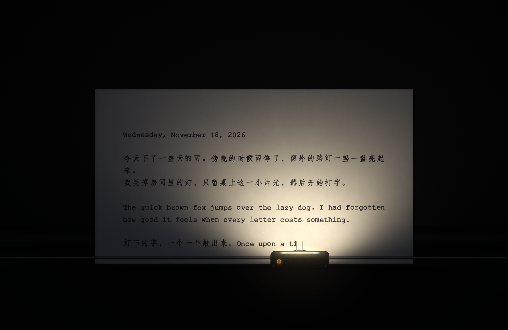

# Lamplight

<p align="center">
  
</p>

<p align="center">
  <a href="docs/demo.mp4">▶ The same film with sound (MP4, 18 seconds)</a> — the sound of the machine is half of this app
</p>

A typewriter for writing with the lights off. The screen is dark; one small lamp on the carriage
lights the paper. Every key you press sends a typebar swinging up to strike the page, and leaves a
letter with ink bleeding at its edges. It is for a daily diary, reading notes and essays.

It is a native Mac app: Swift and SpriteKit, with Metal underneath. Every image in it is drawn by
the program when it starts — there are no image files — and the sounds are recordings of real
typewriters. What you write stays on your Mac; nothing goes online.

The film above was rendered offscreen by the app itself. The close views are a camera moving in
(the app does not zoom); everything else is what you see and hear in the app. This is the whole
window:



One keystroke, frame by frame:


## Build and run

You need a Mac running macOS 14 or later and the Xcode Command Line Tools
(`xcode-select --install`). Full Xcode is not required.

```bash
git clone https://github.com/JiaqiPitt/Lamplight.git
```

Then, in the project folder:

```bash
./scripts/build.sh
```

```bash
open build/Lamplight.app
```

The app is signed ad hoc, which is enough to run it on the Mac that built it. The project was
built and tested on macOS 27 with Swift 6.4; earlier systems have not been tried.

## Using it

It opens on today's diary. The machine types the date at the top of the sheet by itself
(Tuesday, November 17, 2026, for example), and after that you just type.

| Do this | What happens |
|---|---|
| Type | A typebar strikes and the carriage moves one cell to the right. Chinese, Japanese and other input methods work too: what you are composing is pencilled in on the paper, each key gives a soft click, and the characters are struck when you commit them |
| Return | The carriage flies back to the margin and the paper feeds up one line |
| Reach the end of a line | The bell rings a few cells before the end; at the end the line wraps by itself (this can be turned off in the settings) |
| Delete | Correction tape lifts the last character. The faint trace it leaves is gone within 10 seconds. (Delete can be set to Strike out or Overtype instead) |
| Tab | Moves to the next stop, every 4 cells |
| ← → ↑ ↓ | Move the carriage and roll the paper, to go back and type anywhere on the sheet |
| Drag the carriage | It follows the pointer smoothly along the line and drops into the nearest cell when you let go. The pointer turns into a hand over the carriage. (With Travel set to Paper moves it is the paper you drag, and you can take hold of it anywhere along the line) |
| Hold ⌃F / ⌃J | The carriage glides left / right: about 0.7 seconds across a whole line, braking to stop on a cell when you let go. A tap moves it about a word. Any key typed during a glide lands where the carriage is at that moment |
| Scroll | Rolls the paper back to read what came before; it returns when you type again |
| Move the pointer over the paper | It carries a small light of its own, for reading where the lamp does not reach |
| Leave the pointer still for 6 seconds | It disappears, and its light with it; moving the mouse brings both back. Any key hides them at once. (They stay while the drawer or the settings are open, or the pointer rests on the toolbar) |
| Move the pointer | The toolbar appears at the bottom, and hides again when you start typing |
| Switch input source | A one-character mark for the new input source lights briefly on the carriage (A for English; a Chinese or Japanese character for those input methods). Otherwise the carriage shows no text at all |

### Shortcuts

| Key | Action |
|---|---|
| ⌘T | Today's diary |
| ⌘N | New essay |
| ⇧⌘N | New reading note |
| ⌘O | Open the drawer (every sheet you have written) |
| ⌘R | Switch ribbon: black / red (in reading notes, red for quotations and black for your own thoughts) |
| ⌘L | Lights on / off |
| ⌘D | Type the current time |
| ⌘E | Export as a text file |
| ⇧⌘C | Copy all the text |
| ⇧⌘M | Sound on / off |
| ⌃⌘F | Full screen |
| ⌃F / ⌃J (hold) | Glide the carriage left / right |

The glide keys do not use Shift, because Shift-F and Shift-J are capital F and J. To use another
modifier, change `TypewriterView.glideModifier`.

### Settings (the sliders icon at the right end of the toolbar)

| Name | What it does |
|---|---|
| Lamp | Brightness of the lamp |
| Night | How bright everything outside the lamp's light is |
| Volume | Volume |
| Output | Which device the sound is going to (display only; to change it, use the Sound menu in the menu bar) |
| Sound | Which sound pack to use |
| Size | Text size |
| Travel | Lamp moves / Paper moves: whether the carriage travels along the paper or the paper slides under it |
| Delete | Tape (correction tape) / Strike out / Overtype |
| Chinese font | FangSong / Song / Kai |
| Return automatically… | Wrap at the end of a line |
| Dust in the lamplight | Dust drifting in the light |

## Sound

The strike, space bar, carriage return, backspace and bell are cut from recordings of real
typewriters and gathered into sound packs in `Resources/Sounds/`. There are four, and a
synthesised set as a fallback:

| Pack | Source | Character |
|---|---|---|
| Hermes · Natural | A Hermes Precisa 305 manual typewriter | As recorded: short, bright strikes |
| Hermes · ASMR | The same machine, processed for a close sound | More body in the low mids, less harsh treble; key travel and other small sounds brought forward |
| Classic · Natural | Another mechanical typewriter (its model is not named by the source) | As recorded: lower and heavier than the Hermes |
| Classic · ASMR | The same machine, processed in the same way | Closer and softer; its bell and carriage return are borrowed from the Hermes recordings |
| Synthesised | Generated by the program | Fallback |

The default is **Hermes · ASMR**.

To hear them, open `docs/sound-samples.html` in a browser: it has a full demonstration and the
single sounds of each pack. To change the pack in the app: Settings → Sound.

Every strike sample begins as the key starts to go down, so that the moment of impact in the
recording coincides with the slug reaching the paper on screen.

Sources and licences:

- The four packs, and the original recordings in `SoundSources/hermes-precisa-305/`: recorded by
  Joseph Sardin, [BigSoundBank.com](https://bigsoundbank.com), CC0 (public domain).
- `SoundSources/erika-5/typing.mp3` (an Erika 5 from 1940; for reference only, not used in the
  app; the same clip is embedded in the sample page): Work With Sounds / Konrad Gutkowski,
  [Wikimedia Commons](https://commons.wikimedia.org/wiki/File:WWS_Typewriter.ogg),
  [CC BY 4.0](https://creativecommons.org/licenses/by/4.0/), unmodified.

The original recordings are in `SoundSources/`. After changing how they are cut or processed,
rebuild the packs and the sample page from the project folder:

```bash
.build/release/Lamplight --build-packs
```

## Where your writing is kept

All of it on your own Mac, nothing online:

```
~/Library/Application Support/Lamplight/Entries/
```

One JSON file per sheet, for example `diary-2026-11-17-4D717AD1.json`. The file records every
strike — which character, in which cell, in which colour, how hard — so overtyping and
strike-outs are kept exactly as they were made. For plain text, export with ⌘E. Right-click a
sheet in the drawer to move it to the Trash. A sheet with only the date on it is not saved.

## Project layout

```
Sources/Lamplight/
  main.swift                   Entry point; also handles the developer options below
  Model/Entry.swift            A sheet: the grid, the strikes, exporting text
  Model/Store.swift            Reading and writing the JSON files
  Scene/TypewriterScene.swift  The whole machine: paper, carriage, typebars, lamp, and the
                               timing that turns keys into strikes
  Scene/Glyphs.swift           Turns fonts into ribbon ink; draws the page a row at a time
  Scene/Art.swift              Textures for every part of the machine, drawn by the program
  Scene/Shaders.swift          Shaders for the paper grain, the backdrop and the light
  Scene/Layout.swift           Every measurement, scaled to the window
  Audio/SoundBank.swift        Loads sound packs and plays them with low latency; recovers by
                               itself when the output device changes
  Audio/AudioDevices.swift     Asks the system about sound devices (the "Output" row in Settings)
  Audio/Synth.swift            The synthesised fallback sounds
  App/                         Window, keyboard and input methods, toolbar, drawer, settings
  Dev/                         Developer tools: offscreen rendering, the demo film, sample data,
                               window capture, building the sound packs
Sources/ObjCSafe/              A few lines of Objective-C that catch the exceptions the audio
                               framework throws, so the app does not crash
Resources/Sounds/              The finished sound packs (bundled into the app)
SoundSources/                  The original recordings
scripts/build.sh               Builds and wraps build/Lamplight.app (never replaces that copy
                               while it is running; with --wait, swaps it in once it has quit)
scripts/make_icon.sh           Redraws the icon from the scene itself
```

## Developer tools

Render the scene to PNG files without opening a window, to check exactly what is on screen at a
given moment — the frame in which a typebar meets the paper, say:

```bash
.build/release/Lamplight --render-test /tmp/lamplight-shots
```

You can render only some scenarios, or at another window size:
`... --render-test <folder> --size 1000x700 hero strike`.
The scenarios are `intro hero close strike cjk return red fade glide torch lights papermoves scroll`.
`glide` also prints, frame by frame, how the carriage moved while it was dragged and glided (the
largest step between frames, the largest change of step, any step backwards) and the cell it
came to rest in.

Remake the film at the top of this page. It is rendered offscreen — nothing is opened, nothing is
played — and its soundtrack is mixed from the sound pack's recordings:

```bash
.build/release/Lamplight --make-demo /tmp/lamplight-demo
```

It writes `demo.mp4` (60 frames a second, with sound) and a set of small frames, and prints the
`img2webp` command that turns those into `demo.webp` (`img2webp` comes with Homebrew's `webp`).
What is performed, and the camera, are in `Dev/DemoFilm.swift`.

Write every synthesised sound to WAV files and print their levels:

```bash
.build/release/Lamplight --dump-sounds /tmp/lamplight-sounds
```

To try the app without touching your real sheets and without making a sound, use these two
environment variables:

```bash
LAMPLIGHT_DATA_DIR=/tmp/lamplight-data LAMPLIGHT_MUTE=1 build/Lamplight.app/Contents/MacOS/Lamplight --demo "This sentence types itself"
```

Other options:

- `--seed-demo <folder>` writes a few sample sheets.
- `--keys "abc<ret><del>"` sends real key events. `<glide-left:0.4>` and `<glide-right:0.4>` hold
  ⌃F / ⌃J for that many seconds and let go.
- `--drag "-20:0.5@4"` presses on the carriage at second 4, drags it 20 cells to the left in half
  a second and lets go, with real mouse events.
- `--pointer "0.35,0.4@5"` moves the pointer to that point of the window (fractions of its width
  and height) at second 5, and prints what becomes of it once it rests.
- `--carriage-log` prints where the carriage is, and the cursor's cell, every 0.05 seconds.
- `--capture <file> --capture-at <seconds>` has the app photograph its own window
  (`--capture-at 4,6.5` for several pictures).
- `--profile` prints the frame rate before quitting.
- `--no-activate` starts without taking keyboard focus; `--quit-after <seconds>` quits by itself.
- `--sound-pack <id>` chooses a sound pack.
- `--record-audio <file>` records what the app actually plays (it works while muted).
- `--audio-log` prints, before quitting, every start, stop and device change the sound engine went through.
- `--audio-flap "Device@seconds,Device@seconds"` moves the output to another device at those
  moments, to check that the sound recovers by itself.
- `--english-header <sheet.json>` retypes an old diary sheet's Chinese date line in English (only
  if that line really is the date the machine typed).

Every option that begins with `--` must be used together with `LAMPLIGHT_DATA_DIR`; otherwise the
program refuses to start, so that a trial run can never touch a real diary. Two more environment
variables: `LAMPLIGHT_AUDIO_DEVICE="MacBook Pro Speakers"` sends a trial run's sound to a named
device (leaving alone whatever headphones are being worn), and `LAMPLIGHT_AUDIO_IDLE=2` shortens
the time before an idle sound device is released to 2 seconds.

Tools for checking sound without ears: `--audio-scan <file>` lists every sound in a recording with
its loudness, length and brightness; `--spectrogram <file> <start> <length> <output.png>` draws it
as a spectrogram; `--audio-trace <file> <start> <length>` prints the level every 10 milliseconds;
`--audio-balance <file>` reports the band shares and loudness of the whole recording.

## If there is no sound

1. Open the settings and look at **Output**: Lamplight always plays to the Mac's current output
   device.
2. If that is a pair of headphones that is also connected to a phone — AirPods, say — their sound
   belongs to one device at a time. Once the phone has taken them, the Mac still lists them as its
   output, but nothing a Mac app plays reaches your ears. Choose the headphones again from the
   Sound menu in the menu bar, or choose the Mac's own speakers.
3. Whenever any app opens the headphones' microphone, AirPods drop into call mode for about two
   seconds and come back; the sound cuts out for a moment and its quality falls. To avoid that:
   System Settings → Sound → Input, and choose the Mac's own microphone.

A related bug was fixed on 2026-11-17. Until then, once the output device had changed a single
time (every occurrence of item 3 counts), Lamplight stayed silent until it was relaunched. It now
recovers by itself within a few tens of milliseconds.

## Status

Verified:

- Picture: the whole scene, a strike frame by frame, the carriage return, the red ribbon, the
  correction tape, lights on, paper-moves mode, reading back, three window sizes.
- The real app: launching, typing (including Return, Delete, Tab and the arrow keys), the drawer,
  the settings panel, and carrying on with a saved sheet after reopening.
- Dragging and gliding (2026-11-17): run in the real window with real mouse and key events.
  Dragged 30 cells in 0.4 seconds, the carriage stays with the pointer throughout (0.04 cells
  behind when it stops), its step changes by no more than 0.08 cells from one frame to the next,
  and it never moves backwards. Gliding reaches the margin in 0.72 seconds, and neither surges nor
  bounces when the key is released. About 120 frames a second while gliding, with about 0.1 ms of
  logic per frame. The click on passing each cell is the arrow-key sound, 5–10 dB quieter and at
  most 25 a second — that is measured; nobody has yet judged it by ear.
- The pointer hiding after 6 seconds of rest: the timing (6.00 seconds after the last movement)
  and the light going out were measured from screenshots. The pointer itself is only hidden while
  the app is the active window, and test launches do not take focus, so that step has not been seen.
- Frame rate: about 120 frames a second during continuous typing on an M5 MacBook, with less than
  1 ms of logic per frame on average.
- Sound engine: with the output device switched away and back four times during typing, it
  recovered within 28–65 ms each time and dropped 2 of 215 sounds; woken by a key after being
  released for idleness, it takes about 35 ms and drops nothing. These were measured from
  recordings and logs, not heard.

Not yet verified:

- **The sound has only been judged roughly.** The recordings are of real typewriters, but the
  cutting, the balance of levels and the "ASMR" processing were done from spectrograms and
  measurements, not tuned one by one by ear. The default pack, Hermes · ASMR, was chosen after
  listening; the others, and whether the processing goes too far, still need ears. The processing
  is in `Dev/PackRecipes.swift`.
- **The film's soundtrack** is mixed offline from the same recordings, and has not been compared by
  ear with what the app actually plays.
- **A real Bluetooth switch has not been observed.** After the fix the sound was confirmed to be
  back, and every simulated device switch passed. Whether it recovers every time another app opens
  the microphone, or a phone takes the headphones and gives them back, will only be known after
  some time of use with headphones on.
- **The click while dragging and gliding** has not been heard, and **the pointer hiding after it
  rests** has not been seen (see above).
- **Composing with a Chinese input method** — the stage where pinyin is typed but no character is
  chosen yet — has only been simulated in offscreen rendering, not operated with a real input method.
- It has not been run on an external display or on a screen that is not 120 Hz.

## A few facts about this machine

- A line is 60 cells. Latin characters take one cell, Chinese characters two.
- Every character sits, tilts and takes ink slightly differently. That is decided by random
  numbers at the moment of the strike and saved in the file, so it does not change when a sheet
  is reopened.
- There is no undo. A typewriter has no such key.
